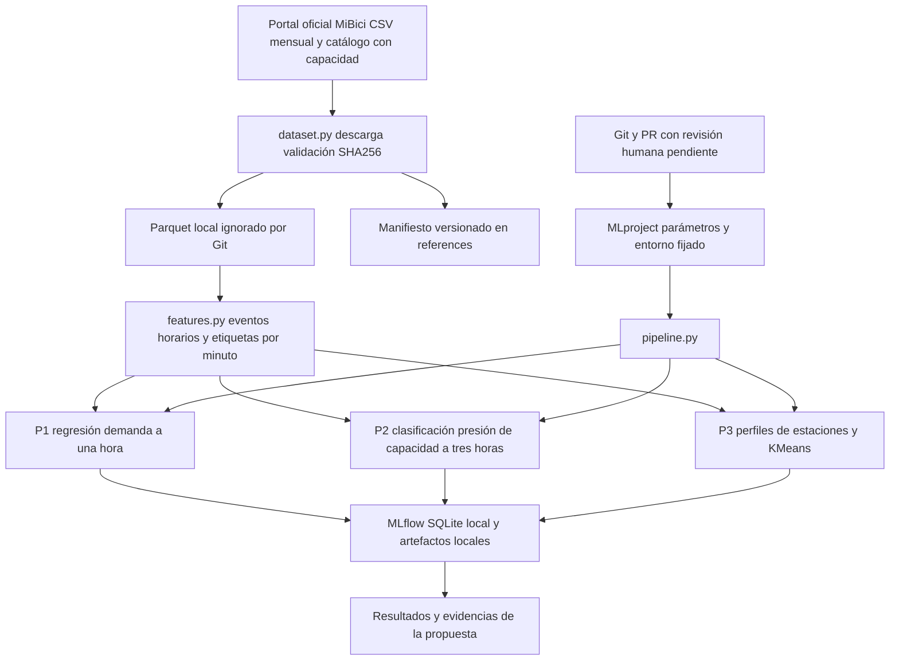

# Arquitectura del experimento MiBici

Python permite funciones comprobables y clases por responsabilidad. Pandas y PyArrow procesan datos tabulares sin incorporar viajes al historial. Scikit-learn compone transformaciones ajustadas solo en entrenamiento y modelos. MLflow Projects define un punto de entrada parametrizado; Tracking conserva procedencia, métricas y artefactos. SQLite y archivos locales permiten trabajar en la laptop sin infraestructura de nube. GitHub conserva historial y revisiones. CCDS separa datos, código, exploración y resultados.

El diagrama describe el experimento offline. No existe servicio productivo, rebalanceo automatizado ni validación con inventario observado.
