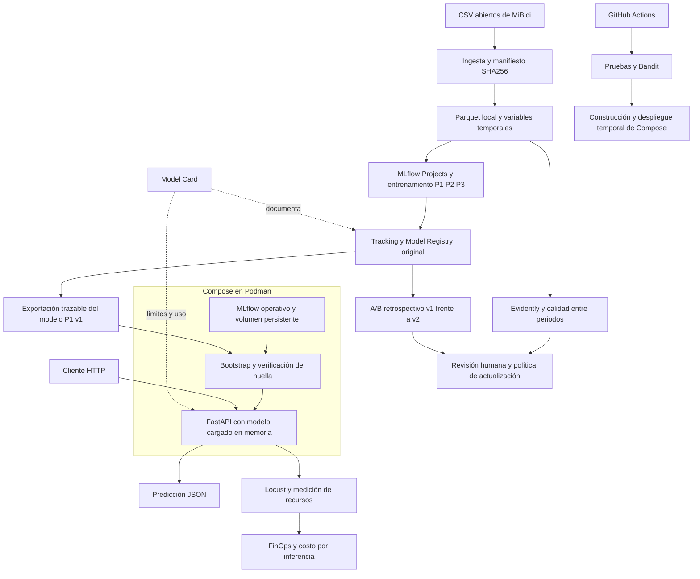
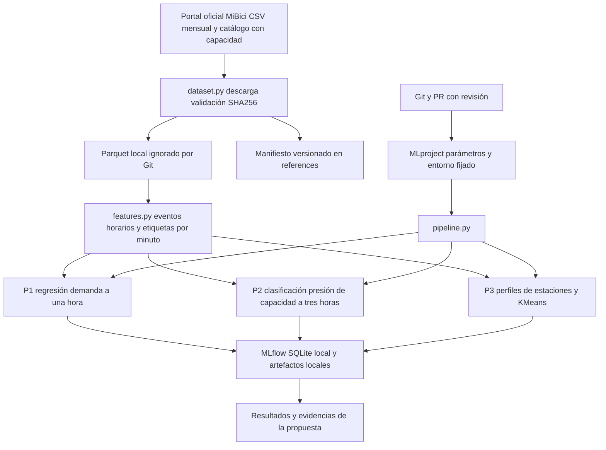

# Arquitectura del proyecto MiBici

## Sistema integrado

El Registry original y la copia operativa son distintos. La API usa P1 v1;
v2 es un challenger recomendado por la evaluación histórica, sin promoción
automática. El modelo se recupera por HTTP al arrancar y permanece en memoria.
SQLite y los artefactos operativos viven en el volumen `registry-data`, fuera
de Git. API y MLflow se conectan por la red interna de Compose. El bootstrap
es una tarea de inicialización, no un tercer servicio de inferencia.

La orquestación y el despliegue demostrados son locales. CI realiza una prueba
temporal con un ejemplo sintético marcado; las mediciones de carga publicadas
usan el P1 real. Evidently y A/B se ejecutan por lotes sobre periodos históricos;
no son una plataforma de monitoreo de tráfico continuo. No hay rebalanceo
automático ni infraestructura cloud contratada.

## Experimento inicial

Python permite funciones comprobables y clases por responsabilidad. Pandas y PyArrow procesan datos tabulares sin incorporar viajes al historial. Scikit-learn compone transformaciones ajustadas solo en entrenamiento y modelos. MLflow Projects define un punto de entrada parametrizado; Tracking conserva procedencia, métricas y artefactos. SQLite y archivos locales permiten trabajar en la laptop sin infraestructura de nube. GitHub conserva historial y revisiones. CCDS separa datos, código, exploración y resultados.

El diagrama describe el experimento offline. No existe servicio productivo, rebalanceo automatizado ni validación con inventario observado.
