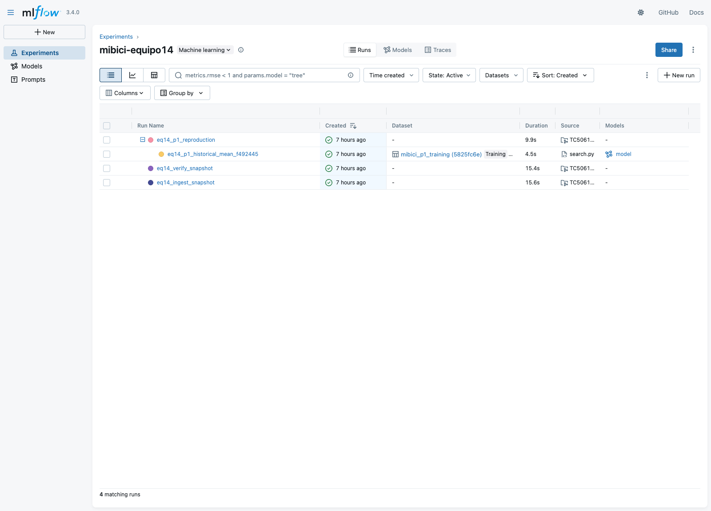
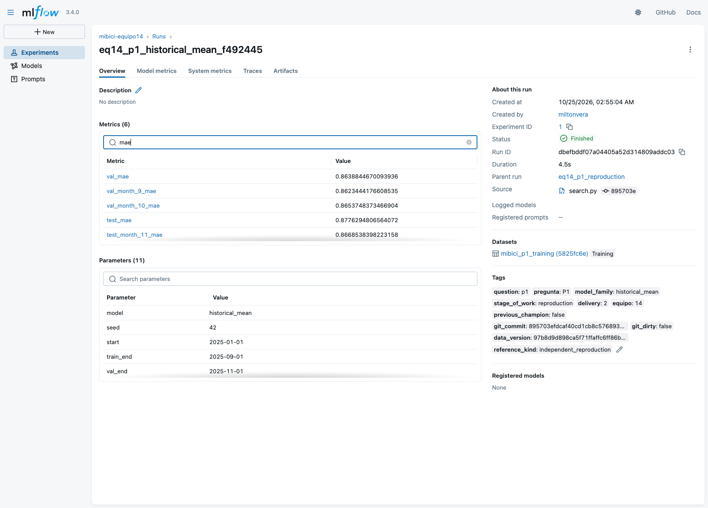
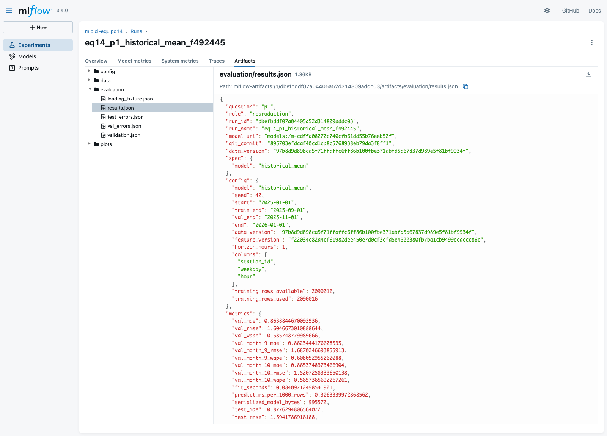

# Comprobación independiente de P1

Milton reprodujo el modelo de demanda por estación para la siguiente hora a partir de la implementación de la segunda entrega. Se ejecutaron la ingesta, la verificación y la reproducción del promedio histórico elegido en la campaña del equipo. La comparación utilizó los resultados versionados de Martha y una base local de MLflow independiente.

## Datos y ejecución

Se comprobaron el SHA256 y el tamaño de las 13 fuentes antes de reutilizar los CSV locales. La ingesta reconstruyó los 14 archivos procesados y conservó 4,532,032 viajes de 2025. El entrenamiento abarca enero a agosto, la validación septiembre y octubre, y la prueba noviembre y diciembre. P1 conserva la cohorte de 369 estaciones definida con entrenamiento.

Se creó un entorno nuevo con Python 3.11.9 y las dependencias de `requirements.lock.txt`. La comprobación confirmó la compatibilidad de las dependencias instaladas. Las tres etapas se ejecutaron mediante MLflow Projects con el experimento `mibici-equipo14`. La reproducción entrenó un modelo `historical_mean`, con 2,090,016 filas de entrenamiento y 540,216 filas en cada partición de evaluación.

## Resultados

| Métrica | Referencia del equipo | Reproducción local | Diferencia absoluta |
|---|---:|---:|---:|
| MAE de validación | 0.8638844670093936 | 0.8638844670093936 | 0 |
| RMSE de validación | 1.6046673010888644 | 1.6046673010888644 | 0 |
| WAPE de validación | 0.585748779989666 | 0.585748779989666 | 0 |
| MAE de prueba | 0.8776294806564072 | 0.8776294806564072 | 0 |
| RMSE de prueba | 1.5941786916188 | 1.5941786916188 | 0 |
| WAPE de prueba | 0.6627981903389160 | 0.6627981903389160 | 0 |

El WAPE se expresa como proporción. Las 18 métricas comparadas, incluidos los desgloses mensuales, coincidieron exactamente. El control del proyecto admite una diferencia absoluta máxima de 0.00000001.

También se cargó el modelo guardado y se compararon sus predicciones completas con un cálculo independiente de los promedios por estación, día de la semana y hora. La diferencia máxima fue cero en validación y prueba. El modelo conserva firma y ejemplo de entrada. Las cuatro corridas locales terminaron correctamente: ingesta, verificación, padre de reproducción y modelo hijo.

## Prueba añadida

`tests/test_milton_p1_loading.py` comprueba que el modelo conserva las predicciones después de guardarlo y cargarlo mediante MLflow. La prueba incluye grupos conocidos, una combinación nueva de una estación conocida y una estación nueva. Los dos casos desconocidos deben recibir el promedio global de entrenamiento. Además, comprueba el orden de salida con índices repetidos, filas reordenadas y llamadas sucesivas.

Este control complementa la prueba existente del estimador en memoria. Comprueba el objeto cargado que se utilizaría para inferencia. Para verificar que detecta una regresión, se cambió temporalmente el respaldo global por cero. La prueba falló por los valores incorrectos y el archivo original se restauró. La suite final aprobó las 25 pruebas.

La prueba `test_historical_mean_keeps_predictions_after_training_data_changes` ajusta una vez el promedio histórico y conserva las predicciones sobre entradas fijas. Después cambia las estaciones, días, horas y objetivos de los datos originales de entrenamiento. El estimador ajustado y el modelo guardado y cargado conservan las predicciones iniciales, incluidos los casos que utilizan el respaldo global.

## Capturas de la reproducción







Las capturas corresponden al experimento local de esta reproducción. Muestran la ingesta, la verificación, el padre de reproducción y su modelo hijo, junto con las métricas y los artefactos registrados.

## Aprendizaje

La comprobación permitió identificar qué elementos se necesitan para repetir P1: fuentes verificadas, particiones temporales y configuración del modelo. Al cargar el artefacto y recalcular las predicciones se pudo contrastar el resultado completo, además de las métricas agregadas.

## Interpretación y alcance

La coincidencia confirma la reproducción local del modelo elegido con las mismas fuentes, particiones y reglas. El error de prueba de aproximadamente 0.878 viajes por estación y hora coincide con el benchmark del equipo. El WAPE de prueba, cercano al 66.28 %, permite dimensionar el error absoluto acumulado respecto al volumen observado. Estos resultados corresponden al modelo elegido por el equipo y a la evaluación histórica de 2025.

La prueba sintética verifica el respaldo global ante claves desconocidas. Las métricas reportadas corresponden a las 369 estaciones de la cohorte definida con entrenamiento.

La instalación reutilizó las cachés de paquetes disponibles y CSV locales verificados. Los avisos de MLflow sobre tipos de entrada y `pywin32` se conservaron en los registros. La instalación en macOS respetó el marcador de plataforma de `pywin32`, previsto para Windows. La carga y la predicción terminaron correctamente.

## Evidencia y reproducción

Los identificadores de versión, corridas, modelo y datos están en `references/validaciones/milton_p1_2026-10-25.json`. Ese archivo conserva las diferencias de las 18 métricas, versiones del entorno, resultados de carga y prueba de regresión. Los datos, la base SQLite y los modelos permanecen en el entorno local.

Con el entorno preparado según el README, se ejecutaron estos comandos desde la raíz del proyecto:

```bash
source .venv/bin/activate
export MLFLOW_TRACKING_URI=http://127.0.0.1:5018
export MLFLOW_REGISTRY_URI=http://127.0.0.1:5018
mlflow run . -e ingest --env-manager local --experiment-name mibici-equipo14
mlflow run . -e verify --env-manager local --experiment-name mibici-equipo14
mlflow run . -e reproduce --env-manager local --experiment-name mibici-equipo14 -P question=p1
python -m pytest -q
```

El servidor se inició en otra terminal, desde esta misma copia:

```bash
source .venv/bin/activate
mlflow server --host 127.0.0.1 --port 5018 --workers 1 \
  --backend-store-uri sqlite:///mlflow.db --serve-artifacts \
  --artifacts-destination ./mlartifacts
```

## Fuentes del proyecto

- Equipo 14. (2026). *Segunda entrega* [Protocolo de experimentación]. `references/segunda_entrega.md`.
- Equipo 14. (2026). *Selección y resultados de P1* [Resultados de la campaña]. `reports/segunda_entrega/selection.json` y `reports/segunda_entrega/results_p1.json`.
