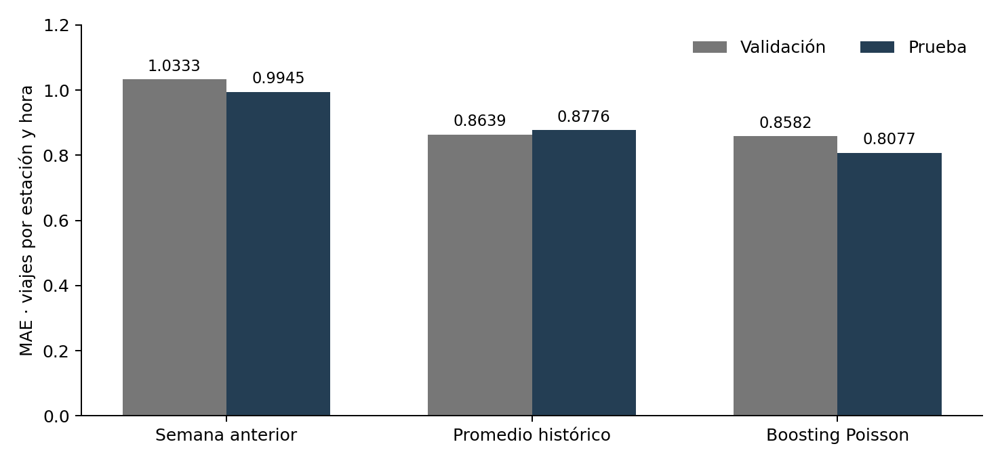

# Proyecto MiBici: ingesta y evaluación de P1

## Alcance y decisión

La ejecución de P1 sobre los viajes de 2025 comparó tres modelos con el MAE de validación y seleccionó el promedio histórico por estación, día de la semana y hora. HistGradientBoosting obtuvo el MAE de validación más bajo, pero su diferencia con el promedio quedó dentro de la tolerancia de 0.01 viajes, y la regla de selección elige el modelo más simple dentro de ese margen.

Milton Vera de la Torre trabajó la ingesta de las fuentes, la definición de los datos de P1, la evaluación de los tres modelos y las pruebas que verifican esas piezas. P2 y P3 mantienen los componentes del proyecto del equipo.

## Fuentes e ingesta

Los datos provienen de los doce archivos mensuales de 2025 que el portal de datos abiertos de MiBici ofrece como descargas CSV, junto con su catálogo de estaciones con nomenclatura de septiembre de 2026 (MiBici, s. f.). Las cifras de este informe se derivan de esos CSV descargados.

La ingesta produjo los siguientes controles:

| Control | Resultado |
|---|---|
| Archivos fuente | 13 (12 CSV de viajes y el catálogo), 393,104,868 bytes |
| Filas de viajes leídas | 4,532,032 |
| Viajes utilizables | 4,532,032 |
| Duplicados eliminados | 0 |
| Filas inválidas | 0 |
| Identificadores en conflicto | 0 |
| Estaciones en el catálogo | 484, con 480 de capacidad positiva |
| Archivos Parquet procesados | 14 |

El módulo `mibici_equipo14/dataset.py` decodifica los CSV de viajes con UTF-8-sig o cp1252, de forma estricta, y normaliza sus encabezados (minúsculas, sin acentos, sin BOM y con separadores unificados) para asignarlos a trip_id, started_at, ended_at, origin_id y destination_id. Los identificadores se leen como texto para conservar los ceros iniciales. Usuario_Id, Genero y Año_de_nacimiento se excluyen, y los datos crudos y los procesados permanecen en el equipo local. Los Parquet de viajes contienen exactamente esos cinco campos, y el catálogo procesado conserva sus campos operativos públicos. Los viajes duplicados idénticos se eliminan una vez, y un identificador con eventos contradictorios detiene la ingesta.

El manifiesto de fuentes registra tamaño, conteos y huella de cada archivo, y la versión de datos se calcula a partir de esas huellas, sin rutas ni fecha de ejecución. Los 14 archivos Parquet procesados tienen registradas su huella, su tamaño y sus filas. Con `--verify` (`dataset.ingest(verify=True)`), el proceso contrasta data_version con el manifiesto antes de reemplazar los Parquet existentes, y si una fuente fue alterada conserva los Parquet anteriores.

## Definición de P1

P1 predice, para cada estación y cada hora t, los viajes que comienzan en la estación durante la hora objetivo, el intervalo [t, t + 1 h). El operador del sistema usaría esa predicción para anticipar la demanda de la hora siguiente. El modelo recibe 13 predictores: salidas y llegadas con rezagos de 1, 24 y 168 horas, medias de 24 y 168 horas desplazadas una hora, y hora, día de la semana y mes.

La cohorte reúne las estaciones con salidas en entrenamiento y entrada en el catálogo, 369 en total. El catálogo de 2026 es un snapshot que se usa como selección retrospectiva de las estaciones de 2025. Cada estación tiene un calendario horario completo, y un cero significa cero viajes registrados en los archivos. Verificar que una estación operaba en una hora concreta requiere fechas históricas de alta y cierre.

Las particiones y sus filas estación hora son:

| Partición | Periodo de 2025 | Filas estación hora |
|---|---|---|
| Entrenamiento | enero a agosto | 2,090,016 |
| Validación | septiembre y octubre | 540,216 |
| Prueba | noviembre y diciembre | 540,216 |

Las primeras 168 horas de 2025 se excluyen por falta de historia para los rezagos. La evaluación es secuencial con horizonte de una hora: cada predicción se emite hora a hora con los rezagos de las horas anteriores ya observadas, también en validación y prueba.

La cohorte queda congelada con el entrenamiento. En entrenamiento, ninguno de los 3,019,431 viajes de la fuente queda fuera de ella. En validación quedan fuera 122 de 796,853 viajes, de la estación 401, y en prueba 433 de 715,748, de las estaciones 401 y 402. Incorporar estaciones nuevas requiere un estudio separado.

## Modelos y selección

El modelo semanal repite las salidas de la misma estación 168 horas antes y se evalúa en las filas con esa historia. El promedio por estación, día de la semana y hora se ajusta solo con las filas válidas de entrenamiento, usa el promedio global de entrenamiento en las combinaciones sin historia y compite como modelo separado del semanal. El candidato es HistGradientBoostingRegressor con pérdida Poisson, 100 iteraciones, tasa de aprendizaje 0.1, 31 hojas como máximo y semilla 42. Los tres modelos se evalúan con los mismos datos de validación y prueba. El MAE es la métrica principal, junto con RMSE y WAPE.

| Modelo | MAE val | MAE prueba | RMSE prueba | WAPE prueba |
|---|---|---|---|---|
| Semanal | 1.0333 | 0.9945 | 1.9142 | 75.11% |
| Promedio | 0.8639 | 0.8776 | 1.5942 | 66.28% |
| Boosting | 0.8582 | 0.8077 | 1.4314 | 61.00% |

La selección sigue la validación y la tolerancia. Boosting tuvo el menor MAE de validación, 0.8582, y el promedio 0.8639, una diferencia de 0.0057 viajes, menor que 0.01. La regla elige el modelo de menor complejidad entre los que están a 0.01 del mejor MAE de validación, con prioridad semanal, promedio y boosting. El semanal queda fuera de la tolerancia, así que la regla selecciona el promedio.

La prueba se reserva para evaluar el modelo elegido. Boosting tiene el menor MAE de prueba, 0.8077, y la selección se mantiene porque la regla predefinida usa el MAE de validación.

El MAE del promedio seleccionado se expresa en viajes por estación y hora: es la diferencia absoluta media entre las salidas predichas y las observadas. Medir el efecto del modelo en las operaciones requiere una evaluación operativa posterior.

## Verificación y trazabilidad

Las 16 pruebas pasaron en 1.09 segundos con Python 3.11.15, pandas 2.2.3, scikit-learn 1.5.2, MLflow 3.4.0, pyarrow 18.1.0 y pytest 8.3.4. Las pruebas de ingesta cubren encabezados CP1252, ceros iniciales en los identificadores, exclusión de campos personales, eliminación de duplicados, conservación de los Parquet cuando una fuente se altera con `--verify` y huellas de los procesados. Las de P1 cubren la estabilidad de la cohorte ante una estación futura, medias calculadas solo con entrenamiento, selección por validación con tolerancia frente al mejor modelo y la orquestación de las cohortes de P1, P2 y P3.

La ejecución registró en MLflow un run padre y tres hijos, todos en estado FINISHED, con 18 métricas numéricas de modelos. Cuatro artefactos de definición guardan las tres definiciones de los hijos y la cohorte del padre. También quedan rastreables el modelo de boosting, las tablas de promedios y los errores por hora y por estación.

`mibici_equipo14/dataset.py` contiene la ingesta, el manifiesto y la verificación. `mibici_equipo14/features.py` construye el calendario horario, la cohorte y los predictores temporales. `mibici_equipo14/modeling/train.py` calcula las predicciones del promedio histórico, aplica la regla de selección y ejecuta el experimento de P1, y las pruebas están en `tests/`. `reports/ingesta_p1_milton.json` documenta la ingesta, y `reports/reproduccion_milton.json` guarda los resultados de P1 con el commit, la versión de datos y el run padre de la ejecución.

## Referencias

MiBici. (s. f.). *Datos abiertos* [Conjunto de datos]. Recuperado el 18 de octubre de 2026, de https://mibici.net/es/datos-abiertos/
